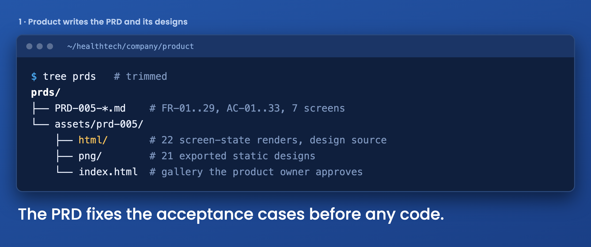
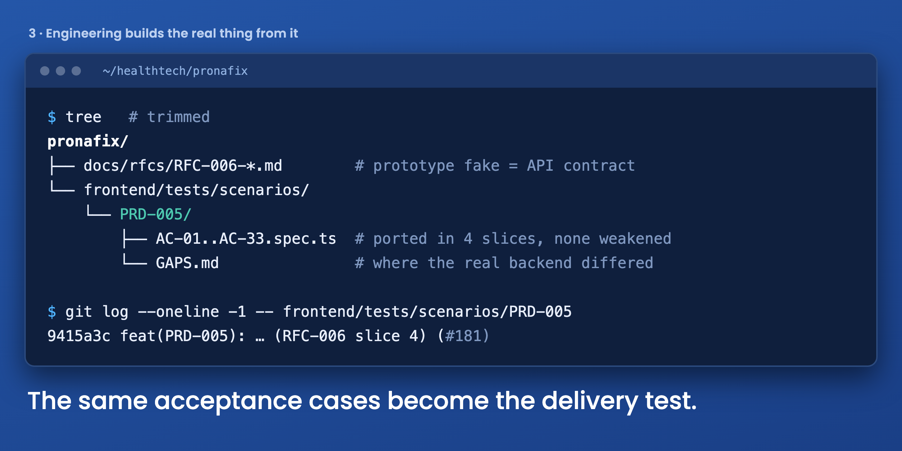
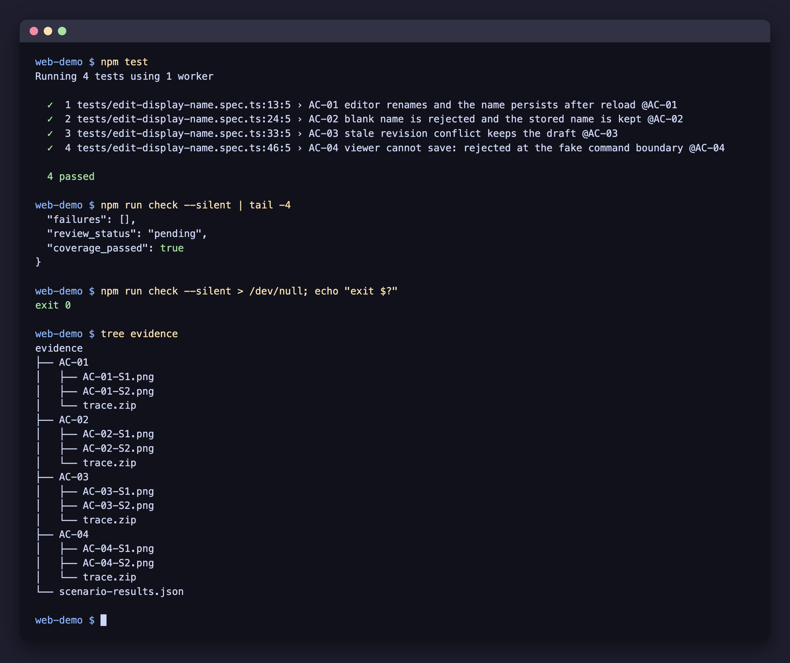

# PRD to Prototype

An agent skill that turns a web PRD into a clickable prototype of your existing app, running on a stateful mock backend, with Playwright acceptance tests as the evidence. Product owners click through the real UI before anyone builds the backend.


<sub>Counts from one real PRD run on a production Next.js app. Commands shortened.</sub>

It exists because of two failures that kept recurring: a mocked session silently selected the wrong navigation branch while every feature assertion passed, and hand-built design mockups drifted from the app that would actually ship. The skill makes the agent start from a pinned copy of the real app, replace only the backend, start every journey at the normal entry route, and prove each acceptance case with recorded screens and traces that a script checks.

Scope: web apps and websites. Native mobile and desktop are phase 2 (see Roadmap).

## What it catches

| Failure | Mechanism |
|---|---|
| Agent guesses where the UI lives or applies its own stack defaults (Next.js habits in an Angular app, new folder layout, different styling) | Step 1 confirms the source location with the user and records stack, data seam, design system and conventions in `ui-profile.md`; later steps must follow it |
| Mock session returns a guessed shape; shell renders the wrong navigation while feature tests pass | Fake must match the real session/flag response; one journey per shell branch asserts the navigation the user sees |
| Design drifts from the shipped app | Baseline is a pinned copy of the real source with a hash manifest; `snapshot.py verify` flags every unexplained change |
| Tests pass because they deep-link straight to the feature | Each AC starts at an entry screen named in the contract; the checker rejects results that do not |
| "Screens covered" claimed from a route list | `expectScreen(...)` records a visit only after a visible assertion passes; the checker compares visited vs required per AC |
| One screenshot or trace reused across cases, or results edited by hand | Reporter writes `scenario-results.json` from the actual run; artifacts must be real trace/video/image files, newer than `run_started_at`, and unique per AC |
| AC expectation quietly edited to make the UI pass | The contract is fixed in step 2; discrepancies are classified and recorded, not patched |
| Green fake suite presented as done | Status vocabulary is fixed: ready for review, review recorded (actor + prototype version), verified against the real backend |

## Quickstart

### Claude Code (plugin)

```text
/plugin marketplace add salismt/prd-to-prototype
/plugin install prd-to-prototype@salismt
```

The skill is then available as `/prd-to-prototype:prd-to-prototype`. Updates arrive through `/plugin` like any other marketplace plugin.

Or clone it as a personal skill:

```bash
git clone https://github.com/salismt/prd-to-prototype.git ~/.claude/skills/prd-to-prototype
```

### Codex

```bash
git clone https://github.com/salismt/prd-to-prototype.git ~/.codex/skills/prd-to-prototype
```

Use `$CODEX_HOME/skills` if you have changed it. [`agents/openai.yaml`](agents/openai.yaml) supplies the display name and default prompt.

### Other Agent Skills hosts

The repository root is the skill folder ([Agent Skills format](https://agentskills.io/specification)). Place the whole folder in your agent's skills directory and keep `scripts/`, `references/`, `adapters/` and `assets/` beside `SKILL.md`.

### Invoke

```text
Use prd-to-prototype with docs/prds/PRD-007-profile.md.
Source repo: /path/to/app (frontend in ./web). Preserve the current shell and session contract.
Build an isolated prototype with a stateful fake and Playwright acceptance evidence.
```

Give it the PRD, the source repo and the scope. If you leave out where the UI lives, or the repo has several candidate apps, it asks before doing anything. It then profiles the stack and conventions, fixes the acceptance contract first, snapshots the app, writes red journeys, builds the feature on a fake, verifies, and hands off with evidence. The steps and their gates are in [SKILL.md](SKILL.md).

## What a run produces

One folder per PRD, next to your PRDs or anywhere outside the product repo. This is the layout after all six steps, taken from a real run (file names inside the app are illustrative):

```text
prototypes/PRD-007/
├── ui-profile.md               # step 1: stack, mock seam, entry route, conventions, open questions
├── coverage-contract.json      # step 2: prd_id, entry_screens, screens, acceptance[]
├── prototype-manifest.json     # step 3: pinned commit, copied paths, per-file hashes, fetch status
├── frontend/                   # step 3: pinned copy of the real app, same repo-relative layout
│   ├── src/
│   │   ├── components/profile/          # step 5: new feature UI, in the app's own conventions
│   │   └── app/api/[...path]/fake/      # step 5: stateful fake behind the existing API seam
│   ├── tests/
│   │   ├── prd-adapter/                 # step 4: screens.ts + prd-reporter.ts (Playwright adapter)
│   │   └── scenarios/PRD-007/           # step 4: one journey per AC, tagged @AC-01, @AC-02, ...
│   └── playwright.prd007.config.ts
├── baseline-evidence/          # step 4: red run against the unchanged snapshot
├── parity-allowlist.json       # step 5: every changed or added path, each with a reason
├── evidence/                   # step 6: written by the reporter, wiped at the start of every run
│   ├── AC-01/
│   │   ├── AC-01-S1.png        # one screenshot per screen, recorded only after its assertion passes
│   │   ├── AC-01-S2.png
│   │   └── trace.zip
│   ├── AC-02/ ...
│   ├── scenario-results.json   # one row per AC, from the actual run
│   └── coverage.json           # check_coverage.py --output
└── HANDOFF.md                  # step 7: commit, commands, AC counts, screens, mocks, status
```

Every path the prototype adds or changes relative to the snapshot must appear in `parity-allowlist.json`, or `snapshot.py verify` fails. Where the fake plugs in depends on your stack; see [web-mocks.md](references/web-mocks.md).

### Where it sits in your workspace

The skill writes only the `prototypes/PRD-007/` folder. In a real team workspace it sits beside the PRD, the design files and the audits that your own design process keeps. The skill reads those files and links to them from the handoff, but does not create them:

```text
workspace/
├── product/                          # your product docs (not created by the skill)
│   ├── prds/
│   │   ├── PRD-007-profile.md        # input: FR/AC/screen ids; handoff note added in step 7
│   │   └── assets/PRD-007/
│   │       ├── html/                 # one HTML render per screen state, the design source
│   │       │   ├── S1-home.html
│   │       │   └── S2-edit-name.html
│   │       ├── png/                  # PNGs exported from that HTML
│   │       └── index.html            # gallery the product owner reviews
│   └── audits/
│       └── 2026-11-01-profile/       # design or UX audit: audit.md, audit.html, screenshots
├── app/                              # the product repo; snapshotted, never edited
└── prototypes/
    └── PRD-007/                      # everything the skill writes (tree above)
```

Keep the two kinds of picture apart: images under `assets/` are static designs, and screenshots under `prototypes/PRD-007/evidence/` were recorded from a passing run.

## Using it in your SDLC

One real PRD, followed from product to merged code. Trees are trimmed; counts come from the files.

**1. Product owns the PRD and the designs.** The acceptance cases are fixed here, before any code. The skill reads them; it does not write them.



**2. The skill builds the prototype.** It copies the real UI, records which cases fail before the change, builds the feature on a fake backend, and records the passing run. The product owner reviews the running prototype and the evidence, not a mockup.


**3. Engineering builds the real thing from the handoff.** The RFC uses the prototype's fake as the API contract. The same acceptance journeys move into the product repo and run against the real backend; any place where the real backend differed goes in a gap log, not into a weaker assertion.



The fake is retired when the real backend lands. "Delivered" means the suite in step 3 passes against the real backend, not that the prototype suite in step 2 passed.

## See it work

[`examples/web-demo/`](examples/web-demo/) is a small app with a PRD, a stateful fake, four acceptance tests using the Playwright adapter, and a coverage contract. Its README has the run commands; the short version:

```bash
cd examples/web-demo
npm ci
npx playwright install chromium   # add --with-deps on a bare Linux box
npm test                          # Playwright suite with the PRD reporter
npm run check                     # scripts/check_coverage.py against coverage-contract.json
```



Break any assertion in the spec and `npm run check` exits 1.

CI runs the same sequence on every push, so the example is always a working reference for wiring the adapter into your own project.

## Package

| Path | Purpose |
|---|---|
| [SKILL.md](SKILL.md) | Six gated steps the agent follows, plus red flags |
| [references/web-mocks.md](references/web-mocks.md) | Where the fake plugs in (fetch client, API route, proxy, MSW), prototype mode, session/flag parity, stateful fake contract |
| [references/evidence.md](references/evidence.md) | Snapshot and allowlist rules, results schema, checker exit codes, handoff record |
| [adapters/playwright/](adapters/playwright/README.md) | `screens.ts` (`expectScreen`) and `prd-reporter.ts`; produces `scenario-results.json` and copies artifacts under `evidence/` |
| [examples/web-demo/](examples/web-demo/) | Runnable end-to-end example used by CI |
| [assets/prd-template.md](assets/prd-template.md) | PRD skeleton with stable FR/AC/screen ids |
| [assets/coverage-contract.example.json](assets/coverage-contract.example.json), [assets/scenario-results.example.json](assets/scenario-results.example.json) | Shape examples only; their artifacts do not exist |
| [scripts/snapshot.py](scripts/snapshot.py) | Copy pinned committed paths; verify changes against an allowlist |
| [scripts/check_coverage.py](scripts/check_coverage.py) | Gate: one passing result per AC, screens visited, real fresh unique artifacts |
| [agents/openai.yaml](agents/openai.yaml) | Codex display metadata |
| [.claude-plugin/](.claude-plugin/) | Claude Code plugin and marketplace manifests |

## Helpers

Python 3.9+ and Git. Standard library only. Run from the skill directory or by absolute path.

```bash
# Copy selected committed paths at a pinned ref. Destination must not exist.
python3 scripts/snapshot.py create \
  --repo /path/to/app --remote origin --fetch --ref origin/main \
  --path frontend --destination /path/to/prototypes/PRD-007

# Report every change against the baseline; exit 0 only when all are allowlisted with a reason.
python3 scripts/snapshot.py verify \
  --prototype /path/to/prototypes/PRD-007 \
  --allowlist /path/to/prototypes/PRD-007/parity-allowlist.json

# Gate the runner's results against the PRD contract.
python3 scripts/check_coverage.py \
  --contract coverage-contract.json \
  --results evidence/scenario-results.json \
  --artifact-root /path/to/prototypes/PRD-007
```

`check_coverage.py` exits `0` when every AC passes with its screens visited and real, fresh, unique artifacts; `1` when the gate is incomplete (one malformed row fails only that AC); `2` when the input itself is malformed. It checks records and files, not the truth of assertions. Open the traces.

The copy-based snapshot is the default because prototypes often live outside the product repo, and a pinned copy with a hash manifest cannot silently mutate the source. A git worktree at the pinned commit works too when the prototype stays in the product repo; review `git diff <commit> --name-status` with the same allowlist rules.

## Validation

```bash
python3 -m unittest discover -s tests -v
```

GitHub Actions runs the helper tests on Python 3.9 and 3.13, then runs `examples/web-demo` end to end (Playwright suite with the reporter, then `check_coverage.py`). The unit tests cover snapshot copying and drift detection, path boundaries, visited-vs-declared screens, missing/duplicate/skipped results, artifact signature and freshness checks, stale review records and exit codes.

## Roadmap

- Phase 2: native mobile and desktop harnesses (same contract and checker, different adapters).
- More runner adapters emitting the same `scenario-results.json` schema.

## License

MIT, see [LICENSE](LICENSE).
